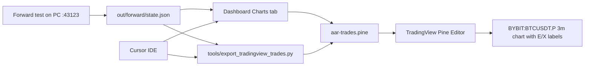

# Cursor + TradingView — review recent trades on charts

There is **no official TradingView ↔ Cursor plugin**. The practical setup is: **AAR records trades locally** → **export Pine markers** → **paste into TradingView** while you work in Cursor.

## Architecture



## On your Windows PC (recommended)

1. Run **`START-HERE-43123.bat`** (or 24/7 watchdog) so forward test writes `out/forward/state.json`.
2. Open dashboard → **Trading desk** → **Charts** tab (embedded TradingView + export buttons).
3. Click **Copy Pine markers** or **Download .pine**.
4. In [TradingView](https://www.tradingview.com/chart/?symbol=BYBIT%3ABTCUSDT.P&interval=3):
   - Bottom panel → **Pine Editor** → New
   - Paste → **Save** → **Add to chart**
5. Match symbol **`BYBIT:BTCUSDT.P`** and interval **3m** (same as strategies / Hyro Bybit path).

Re-copy Pine when new trades close (markers are a snapshot, not a live stream).

## From Cursor terminal

```bash
cd "C:\Users\User\OneDrive\Desktop\AAR-YA-PAAR 12"
python3 tools/export_tradingview_trades.py
```

Outputs:

- `out/tradingview/aar-trades.pine` — paste into TradingView
- `out/tradingview/aar-trades.csv` — spreadsheet / archive

HTTP (local engine only):

```text
GET http://127.0.0.1:43123/api/trades/tradingview?format=pine
GET http://127.0.0.1:43123/api/trades/tradingview?format=csv
GET http://127.0.0.1:43123/api/trades/tradingview?format=json
```

## Remote (Vercel UI + home PC engine)

If the dashboard is on Vercel but the engine is on your old PC:

1. Set **`NEXT_PUBLIC_AAR_API_URL=http://100.x.x.x:43123`** (Tailscale IP of the PC).
2. Use the Charts tab there; export calls hit the home API (CORS is enabled for your setup).

TradingView still runs in **your browser**; Cursor only edits code and runs the export script.

## Backtest trades + levels on the chart

TradingView has **no live link to Cursor**. For **backtests**, run the export script after a backtest JSON exists:

```bash
cd path/to/AAR-YA-PAAR
# Option A — run backtest and export in one step (needs cached klines)
PYTHONPATH=. python3 tools/export_tradingview_trades.py --backtest-config config.btc.london-mid-engulf-winner.toml

# Option B — export an existing report
PYTHONPATH=. python3 tools/export_tradingview_trades.py --report out/reports/btcusdt-london-mid-engulf.json
```

Outputs the same folder: `out/tradingview/aar-trades.pine` and `aar-trades.csv`.

Paste Pine in TradingView (Pine Editor → Add to chart). Match **symbol** `BYBIT:BTCUSDT.P` and **3m** (or your config interval).

| Chart element | Meaning |
|---------------|---------|
| **E** / **X** labels | Entry and exit |
| Teal horizontal line | Entry price for the life of the trade |
| Red dashed | Stop level (from config `stop_usdt`, approximate) |
| Green dashed | Target level (from config target / R:R, approximate) |

Session **grid levels** (anchor ladder) are not exported yet — only fills and stop/target lines. Re-run export after each new backtest.

## What TradingView cannot do here

- Live sync from Cursor without re-exporting Pine
- Order flow / footprint from our kline-only engine
- Official MCP server for TradingView (use Pine export instead)

## Marker legend

| Label | Meaning |
|--------|---------|
| **E** | Entry (teal up = long, orange down = short) |
| **X** | Exit (gray) |
| Tag | strategy id · exit reason · side |

Open positions show **OPEN** until closed.
